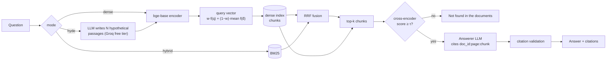

# HyDE RAG v2

**When does HyDE (Hypothetical Document Embeddings) actually help, and does it still hold for
food-safety quality documents?** An open-source RAG system and benchmark, built and run entirely
on free tiers. Every number below is generated from `results/` by `uv run hyde-rag results`.

> **Status:** the BEIR reproduction and the SciFact generation study are complete. The food-safety
> benchmark (F1: domain-instructed HyDE; F2: a fine-tuned embedder) has its 205-question eval set;
> HyDE passages are being generated on the free tier. See [Roadmap](#roadmap).

## Headline (BEIR, nDCG@10)

<!-- results:start (generated by `hyde-rag results`; do not edit) -->
| System | scifact nDCG@10 (ours / paper) | trec-covid nDCG@10 (ours / paper) | LLM tokens / query | CPU ms / query |
|---|---:|---:|---:|---:|
| BM25 (bm25s, Pyserini-flat settings) | 67.7 / 67.9 | 59.3 / 59.5 | - | 0 |
| Contriever (paper's encoder) | 64.9 / 64.9 | 27.4 / 27.3 | - | 72 |
| HyDE + Contriever, gpt-oss-120b, N=1 | 67.4 / 69.1 | 56.8** / 59.3 | 521 | 764 |
| HyDE + Contriever, gpt-oss-120b, N=4 (Eq. 8) | 61.0 / - | 46.9** / - | 2,099 | 3,073 |
| HyDE + Contriever, N=4, query weight 0.5 (ours) | 67.7 / - | 58.9** / - | 2,099 | 3,062 |
| bge-base-en-v1.5 (modern supervised) | 74.0 / - | 78.1 / - | - | 78 |
| HyDE + bge, gpt-oss-120b, N=1 | 78.6** / - | 83.4 / - | 521 | 754 |
| HyDE + bge, gpt-oss-120b, N=4 (Eq. 8) | 78.5* / - | 77.2 / - | 2,099 | 3,083 |
| HyDE + bge, N=4, query weight 0.5 (ours) | 77.8** / - | 84.8** / - | 2,099 | 3,075 |
| Hybrid BM25 + bge (RRF) | 74.1 / - | 80.6 / - | - | 78 |
| Hybrid BM25 + HyDE-bge | 75.7 / - | 80.4 / - | 2,099 | 3,083 |
| BM25 + Query2doc expansion | 71.9 / - | 57.7 / - | 2,099 | 1 |
| Multi-query (RAG-Fusion) BM25 + bge | 75.8 / - | 83.7 / - | 207 | 308 |
| Rerank (MiniLM-L6) of bge top-100 | 69.3 / - | 77.1 / - | - | 11,931 |

\* p < 0.05, \*\* p < 0.01 vs the same encoder without HyDE (paired randomisation, Holm-corrected). Tokens and CPU time are from SciFact. All LLM calls on free tiers: $0.
<!-- results:end -->

Full tables with confidence intervals, R@10, R@100, capped R@100 and MRR@10:
[`docs/RESULTS.md`](docs/RESULTS.md). CPU ms is single-query retrieval on an i5-1235U laptop and
includes encoding the hypothetical documents; LLM time is on top of it (about 1.3–1.8 s on Groq).

## Findings

Differences are paired over the same queries, with 95% bootstrap CIs. SciFact has 300 queries and
TREC-COVID 50.

1. **The paper reproduces.**
   - BM25 and Contriever land within 0.2 nDCG of the paper on both datasets, and Contriever's
     TREC-COVID capped recall@100 is 17.2, exactly as reported.
   - HyDE + Contriever with an open model (gpt-oss-120b, N=1) is 1.7–2.5 points below the
     paper's text-davinci-003 numbers.
2. **The paper's averaging (Eq. 8) breaks as N grows.**
   - At N=4 the question gets only 1/5 of the HyDE vector. HyDE + Contriever falls from 67.4 to
     61.0 on SciFact, below plain Contriever.
   - Keeping the question at a fixed 50% fixes it: +6.7 [+4.6, +8.9] on SciFact and
     +12.0 [+7.9, +16.3] on TREC-COVID.
   - The weight was picked on SciFact, so TREC-COVID is an out-of-sample check
     ([D-HYDE-8](docs/DECISIONS.md)).
3. **HyDE still helps a modern supervised embedder.**
   - bge-base: SciFact 74.0 → 78.6 (+4.5, p = 0.003); TREC-COVID 78.1 → 84.8 (+6.7, p = 0.002).
   - Run naively (Eq. 8 at N=4), the TREC-COVID gain disappears (77.2), which would wrongly
     suggest HyDE no longer works on modern embedders.
4. **One hypothetical document is enough.**
   - N=4 with the fixed weight is within noise of N=1 for both encoders on both datasets
     (−0.8 to +2.1, all p > 0.1), and N=4 under Eq. 8 does worse than N=1.
   - N=1 uses a quarter of the LLM tokens (521 vs 2,099 per query).
5. **Cheaper LLM tricks come close.**
   - Multi-query rewrites (RAG-Fusion) over BM25 + bge use about 200 tokens per query. They
     match HyDE on TREC-COVID (83.7 vs 84.8, n.s.) but trail it on SciFact (75.8 vs 78.6,
     p = 0.03).
   - Plain hybrid BM25 + bge, with no LLM at all, reaches 80.6 on TREC-COVID.
6. **A small cross-encoder hurts strong retrievers.**
   - Reranking bge's top 100 with MiniLM-L6 lowers SciFact from 74.0 to 69.3 (p = 0.03).
   - It helps BM25 (TREC-COVID 59.3 → 73.7) and costs about 10 s per query on a laptop CPU.
   - So the answer pipeline doesn't rerank (decided on the SciFact dev split).
7. **Better retrieval didn't give better answers on SciFact.**
   - Over 100 claims, HyDE-bge vs bge: verdict accuracy 0.80 vs 0.83 (n.s.), faithfulness
     0.87 for both.
   - Gold evidence was already in the top 3 for 92–95% of claims, so the answerer wasn't limited
     by retrieval.
   - Judge faithfulness is pending validation against human labels.

**Food-safety documents:** pending. The 205-question eval set is built; HyDE passages are being
generated on the free tier.

## How it works



- **Retrieval, every method a config entry** (`configs/experiments/*.yaml`):
  - BM25 (bm25s, Pyserini "flat" settings);
  - dense: Contriever (paper parity) and bge-base-en-v1.5;
  - HyDE (paper Eq. 8, N ∈ {1, 4, 8}) plus a query-weight variant;
  - hybrid RRF, hybrid + HyDE, Query2doc, multi-query (RAG-Fusion);
  - cross-encoder rerank (MiniLM-L6).
- **Grounded generation:**
  - inline citations, validated after generation;
  - a two-layer "not found" fallback: a cross-encoder gate τ calibrated on a dev split with a
    false-refusal cap, plus a prompt rule.
- **Evaluation:**
  - trec_eval metrics (nDCG@10, R@10, R@100, MRR@10);
  - paired bootstrap CIs (10K resamples) and a paired randomisation test with Holm correction;
  - latency and LLM tokens per query (no dollar costs: everything is free tier);
  - claim-level faithfulness and citation precision from an LLM judge, checked against 50 human
    labels;
  - abstention precision, recall and false-refusal rate.
- **Food-safety corpus:**
  - 41 public documents (FDA, USDA FSIS, Codex, FSSAI);
  - per-document licence notes in [`data_sources.yaml`](data_sources.yaml);
  - only US federal (public-domain) files are committed; everything else is fetched by
    `scripts/download_food_corpus.py`;
  - column-aware PDF parsing, section-bounded chunks, and span-based gold evidence, so scores do not
    depend on chunking.

## Quick start

Needs [uv](https://docs.astral.sh/uv/). Works on Windows, macOS and Linux. **No API key is needed to
reproduce the results:** every LLM output (hypothetical documents, answers, judgements) is cached
under `cache/` and committed.

```bash
uv sync --all-extras
uv run python scripts/download_beir.py scifact
uv run hyde-rag encode --dataset scifact --encoders contriever bge-base
uv run hyde-rag run configs/experiments/scifact.yaml
```

`make reproduce-beir` runs the full BEIR pipeline. Encoding TREC-COVID takes about 30 CPU-hours, so
use [`notebooks/encode_trec_covid_colab.ipynb`](notebooks/encode_trec_covid_colab.ipynb) on a free
Colab GPU, then `uv run hyde-rag verify-index --dataset trec-covid --encoder bge-base`.

### Ask questions over the food corpus

```bash
uv run python scripts/download_food_corpus.py
uv run hyde-rag ingest-food
uv run hyde-rag index-food --encoders bge-base
uv run hyde-rag ask "What temperature must hot-held TCS food be kept at?"
```

New questions call an LLM, so they need a free Groq key in `.env` (see `.env.example`), or any
OpenAI-compatible endpoint such as local Ollama. The client **refuses keys on a paid plan** unless
you opt in.

### API and demo

```bash
make api    # FastAPI on :8000, POST /query {"question": "...", "mode": "hyde"}
make demo   # Streamlit UI
docker build -t hyde-rag . && docker run -p 8000:8000 --env-file .env hyde-rag
```

## Zero cost, by design

| Need | Free option used |
|---|---|
| LLMs (HyDE, answers, judge, question drafts) | Groq free tier: `gpt-oss-120b`, `gpt-oss-20b`, `qwen3.8-27b` |
| GPU encoding and fine-tuning | Free Colab T4 notebooks in `notebooks/` |
| Rate limits | A paced, resumable runner with a quota estimator (`uv run hyde-rag quota`) |
| Reproducibility | Generations cached and committed; cache keys exclude secrets |

## Roadmap

- [x] BEIR reproduction: BM25, Contriever and BM25 + CE within 0.2 nDCG of the paper
- [x] HyDE on a modern embedder, N sweep, hybrid, Query2doc, multi-query, rerank
- [x] SciFact grounded generation, abstention gate, LLM judge
- [ ] Human validation of the judge (50 labelled claims)
- [x] Food eval set: 205 questions (62 dev / 143 test), LLM-reviewed from 329 drafts
      ([D-EVAL-7](docs/DECISIONS.md)); human audit of 40 decisions pending
- [ ] F1: generic vs domain-instructed HyDE on food documents
- [ ] F2: bge-base fine-tuned on synthetic food queries
      ([`notebooks/finetune_food_embedder_colab.ipynb`](notebooks/finetune_food_embedder_colab.ipynb))
- [ ] Blog post: "Does HyDE still help in 2026? I measured it." (draft in `docs/blog/`; food numbers pending)

## Docs

- [`docs/RESULTS.md`](docs/RESULTS.md): every system, every metric, with CIs
- [`docs/blog/does-hyde-still-help-in-2026.md`](docs/blog/does-hyde-still-help-in-2026.md): the write-up (draft)
- [`docs/DECISIONS.md`](docs/DECISIONS.md): every design decision, with its evidence
- [`docs/PLAN.md`](docs/PLAN.md) and [`docs/QUOTA_PLAN.md`](docs/QUOTA_PLAN.md): the experiment
  plan and the free-tier budget
- [`NOTICE`](NOTICE): dataset and model licences

## Citation

This repository re-implements the method from:

```bibtex
@inproceedings{gao-etal-2023-precise,
  title     = {Precise Zero-Shot Dense Retrieval without Relevance Labels},
  author    = {Gao, Luyu and Ma, Xueguang and Lin, Jimmy and Callan, Jamie},
  booktitle = {Proceedings of the 61st Annual Meeting of the Association for Computational
               Linguistics (Volume 1: Long Papers)},
  year      = {2023},
  pages     = {1762--1777},
  url       = {https://aclanthology.org/2023.acl-long.99}
}
```

If this benchmark is useful to you:

```bibtex
@software{tiwari_hyde_rag_v2,
  author = {Tiwari, Sudhanshu},
  title  = {{HyDE RAG v2}: when does HyDE help?},
  year   = {2026},
  url    = {https://github.com/Sudhanshu1st/hyde-rag-v2}
}
```

Version 1 of this project: <https://github.com/Sudhanshu1st/HyDe_RAG>.

Code: MIT. Data and models keep their own licences; Contriever (CC BY-NC) is used only for
benchmark parity, and the API and demo use bge-base-en-v1.5 (MIT). See `NOTICE`.
